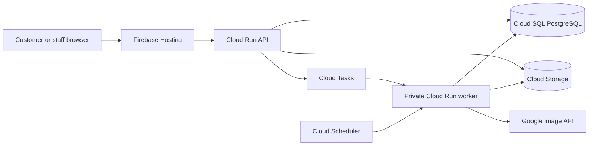

# Virtual clothing try on architecture

## Mobile experience amendment — approved 2026-10-27

The owner's mobile follow-up and constitution2.0.0 supersede earlier clauses requiring blocking photo-consent/age/ownership checkboxes, customer provider/model/evaluation banners and dense generation warnings. The customer path is choose saree→add photo→view Virtual preview. A deliberate request is recorded as USER_ACTION with version/time and NULL legacy attestation fields; historical legacy records stay truthful. Generic photo handling/retention is available through a passive Privacy link. Provider provenance, budgets, deployment diagnostics and production quality review stay internal/operator-facing. Existing role/privacy/retention/CSRF/quota and callback-contact boundaries remain.

Customer login persists for up to30days (30-day server idle); workforce stays8hours idle, anonymous30minutes and temporary credentials their absolute24hours. Persistent __session remains Secure/HttpOnly/Lax in GCP; no authentication secrets in localStorage. Existing pre-update cookies may need one new sign-in. Transient/offline refresh is reconnect state, not asserted logout; resume revalidates read-only work with stale-response protection.

Customer mobile screens use compact headers, safe-area bottom navigation and reachable44px actions; Pearl/Sage/Midnight/System appearances persist without first-paint flash or image recolouring. Focused browser/background/reload/race/theme/accessibility tests and actual GCP/CI evidence are required. Feature009 contains the authoritative contract and acceptance details. Android/iOS binaries and new infrastructure remain out of scope.

This is the implementation baseline for the Phase 1 PRD. Keep a single backend codebase with clear modules and one public versioned API. Use managed services where they remove operational work without obscuring their cost.

## 1 Stack decisions

| Layer | Choice | Reason |
| --- | --- | --- |
| Backend | Java 21 LTS, a currently supported Spring Boot release, Maven Wrapper, Spring Security | Preserves the preferred language; suitable for the relational permission and enquiry workflows. Pin exact framework versions during planning. |
| Web | React, TypeScript and Vite | Straightforward responsive customer and staff interfaces with static deployment. |
| Later mobile | React Native and Expo | Use the same REST API. Share API types/client logic where useful; do not promise web UI code will transfer unchanged. |
| Database | PostgreSQL, Flyway migrations, local Docker, Cloud SQL in GCP | Transactions support membership rules, ticket claiming, history and quota reservation. |
| Web hosting | Firebase Hosting | Static React files and same-origin API rewrites to the Cloud Run API. Verify the chosen region supports the rewrite arrangement. |
| Backend hosting | Cloud Run API and private worker, built from the same backend image | Durable asynchronous image work without a separate business service codebase. |
| Images and video | Cloud Storage | Separate public catalog derivatives from private customer media. |
| Queue | Cloud Tasks with authenticated delivery | Persistent work and controlled dispatch to the worker. |
| Scheduled maintenance | Cloud Scheduler invoking a private worker endpoint | Expiry, abandoned-upload cleanup and reconciliation of undispatched jobs. |
| Secrets and operations | Secret Manager, Cloud Logging and Monitoring | Backend-only credentials and basic operational visibility. |
| Image provider | Configurable Google image model through a small adapter | Model choice follows the saree benchmark and can change without rewriting customer workflows. |

Do not switch to Python solely to claim lower hosting cost. Both languages can call managed image APIs. Actual costs depend on resource sizing, concurrency, request duration, cold starts and provider usage. Spring Boot is the baseline; optimize its container after measuring.

Do not introduce Kubernetes, service mesh, Kafka, Redis, Elasticsearch, a separate Python image service or a generalized AI-agent framework for this MVP. Start with PostgreSQL search and polling.

## 2 Request and generation flow

The browser reads and mutates application data through `/api/v1`. Photo uploads use short-lived upload authorization to a server-selected object key, followed by backend validation/finalization. The API rechecks ownership and store scope before finalizing an object. Bucket CORS and upload limits must match the documented browser flow.

To generate a preview, the API transaction creates a job and reserves quota/spend. It then enqueues the job ID. A failed enqueue leaves a persistent undispatched state; a scheduled reconciliation process safely retries dispatch. Queue messages carry IDs, never photo bytes or customer contact details.

The private worker atomically claims the job and calls the provider, stores the result privately and records the terminal state. The UI polls the API with backoff, initially about every 3 seconds, pausing unnecessary polling when hidden. Job completion must survive the browser closing.

Cloud Tasks invokes the worker with OIDC and a narrowly scoped service account granted Cloud Run Invoker. Cloud Tasks can redeliver, so local processing must be idempotent. An ambiguous model timeout may still represent a billed provider call; record UNKNOWN_OUTCOME and reconcile or require a deliberate new attempt rather than promising exactly-once provider execution. [Cloud Run task delivery](https://docs.cloud.google.com/run/docs/triggering/using-tasks), [Cloud Tasks pitfalls](https://docs.cloud.google.com/tasks/docs/common-pitfalls).

Use one Cloud Storage private-media bucket with purpose-specific prefixes and retention settings that do not accidentally delete saved outputs. Lifecycle rules are a backstop; database-driven deletion handles explicit requests. Provider calls use the workload service identity where supported, not downloadable service-account keys.

Use IAM Credentials for keyless signed URLs, enabling `iamcredentials.googleapis.com` and granting only the required signing permission on the signing service account plus the required storage access. Avoid granting project-wide Token Creator merely for convenience. [Google signed URL prerequisites](https://docs.cloud.google.com/storage/docs/access-control/signing-urls-with-helpers).

## 3 Modules and data

Backend modules: identity, stores/memberships, catalog/media, try-on/jobs/gallery, enquiries/messages, and operations/demo tools. Keep them in one application and database. An API mode exposes public routes; a worker mode exposes only authenticated internal task/maintenance routes. Public API deployments must not expose callable worker routes.

Core records:

- User, password credential, recovery code hash, session and global role.
- Store and store membership with role and active state.
- Category, global/store brand, product, tag, product media and validated upload.
- Try-on job, private media object, saved preview, consent record and generation budget reservation/ledger.
- Enquiry, product snapshot, assignment/status event and message with PUBLIC or INTERNAL visibility.
- Audit event and demo dataset manifest.

Put `store_id` on store-owned records and scope access in service/repository queries. Do not trust a submitted store ID, assignment target, object key or customer ID merely because it appeared in the UI.

Use database transactions and an explicit concurrency design for final-admin protection, ticket claiming, active-enquiry deduplication and quota reservation. Test those behaviors against PostgreSQL rather than relying only on mocks or an in-memory database.

## 4 Authentication

For web Phase 1, use Spring Security and server-side sessions persisted in PostgreSQL, Secure/HttpOnly/SameSite cookies and CSRF protection. Firebase Hosting forwards `/api/**` to Cloud Run so ordinary API requests remain same-origin. Name the session cookie `__session`: Firebase Hosting strips other incoming cookies, so Spring's default cookie name will not work through this rewrite. Expose a session-backed CSRF token through a no-store bootstrap endpoint and send it in a request header rather than relying on a second cookie. Set `Cache-Control: no-store` on authentication and private API responses. Restrict CORS separately for authorized storage uploads and local development. [Firebase cookie behavior](https://firebase.google.com/docs/hosting/manage-cache#using_cookies).

Do not persist session secrets in browser local storage. Enforce password rotation for newly provisioned staff before allowing other business routes. Check current memberships on each request so revocation is not delayed by stale role claims.

Keep workforce and customer credential namespaces separate. Super-admin workforce password resets cannot grant access to a customer's private workspace. Private media URLs have a maximum five-minute lifetime; deletion stops issuing them immediately.

Standard Firebase Hosting rewrites require a Cloud Run API reachable by the Hosting integration. Permit invocation at the Cloud Run layer and enforce application authentication in Spring Security; apply the same controls on the direct run.app URL. Firebase Hosting is not an authorization boundary. Keep the worker IAM-private. [Hosting and Cloud Run setup](https://firebase.google.com/docs/hosting/cloud-run).

For signup CAPTCHA, validate the assessment's token validity, expected action and hostname, and configured risk threshold on the server. A token's presence in the form is insufficient. [Google CAPTCHA assessments](https://docs.cloud.google.com/recaptcha/docs/create-assessment-website).

Native clients are a later phase: define a reviewed OAuth/OIDC token flow when mobile development starts, while keeping domain endpoints and authorization shared. Phase 1 does not implement speculative mobile authentication infrastructure.

## 5 AI model choice and cost

As checked on 26 October 2026, Google documents Nano Banana 2.1 (`gemini-nano-banana-2.1`) and other Gemini image models as try-on options. Treat that as a benchmark candidate, not a saree-quality guarantee. [Google try-on guide](https://docs.cloud.google.com/gemini-enterprise-agent-platform/models/capabilities/generate-virtual-try-on-images).

Do not make `virtual-try-on-001` the long-term default: its current model card lists deprecation on 14 September 2026 and retirement on 15 March 2027. Recheck current lifecycle and supported replacement models when implementing. [Google model card](https://docs.cloud.google.com/gemini-enterprise-agent-platform/models/vto/virtual-try-on-001).

Use a provider adapter with generation, usage reporting and explicit failure classification. Configure model ID and AI location through backend environment settings. Application/storage location and model location are separate decisions; an India application region does not establish that inference runs in India. Disclose cross-region processing if applicable.

Illustrative current Nano Banana 2.1 standard global pricing: two 1,120-token input images at US$1.50 per million input tokens plus one 1,120-token 1K output at US$30 per million image-output tokens cost about **US$0.03696** before text/reasoning. Thus 1,000 single-attempt outputs are about **US$36.96**, excluding text/reasoning, failed/extra attempts, infrastructure, tax and currency conversion. Revalidate rates and token behavior before budgeting. [Official pricing](https://cloud.google.com/gemini-enterprise-agent-platform/generative-ai/pricing).

Compare models using `total billed generation spend / number of human-accepted results`. A cheaper individual request can cost more per usable saree preview if many results fail the fidelity test.

Use one output, modest resolution, atomic customer/global limits, a conservative provider-budget reservation, bounded retries, worker concurrency limits and a manual generation kill switch. Cloud billing alerts supplement application controls; an alerts-only budget is not a hard spending cap. [Budget behavior](https://docs.cloud.google.com/billing/docs/how-to/budgets).

## 6 Hosting costs and operations

Cloud Run request-based billing with minimum instances set to zero permits scale-to-zero and cold starts. A warm instance trades additional cost for startup latency. Measure before choosing. [Cloud Run minimum instances](https://docs.cloud.google.com/run/docs/configuring/min-instances).

Cloud SQL has a persistent cost floor and does not scale to zero with Cloud Run. Stopping it makes the app unavailable, and some storage/IP charges can continue. Run PostgreSQL locally until a shared demo is needed; create one appropriately sized demo database rather than duplicating idle environments. [Cloud SQL pricing](https://cloud.google.com/sql/pricing), [stop/start behavior](https://docs.cloud.google.com/sql/docs/postgres/start-stop-restart-instance).

If near-zero idle cost becomes a hard requirement, revisit Firestore as a deliberate architecture change. It is not a transparent substitute for the relational design, and no complete monthly price is promised without traffic, storage, region and generation-volume assumptions.

Deployment must configure database connection pool and Cloud Run instance limits together, private worker IAM, authenticated scheduled maintenance, upload CORS, database backups, media lifecycle/soft-delete retention, logs and budget alerts. Keep local, demo and production configuration distinct. Pin dependencies and container versions after verifying current support; commit lockfiles and the Maven Wrapper.
